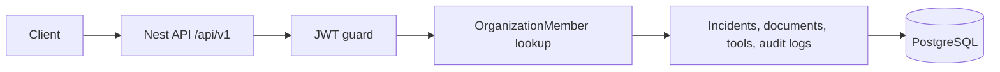

# DevOpsAI

NestJS API for organization-scoped incident management. Users register into an organization, sign in with a JWT, and work with incidents, runbooks, and operational tools inside that organization.

## Features in this tree

- Register and log in. Passwords are hashed with bcrypt. Login returns a bearer token.
- Organizations, users, and memberships with roles `ADMIN`, `ENGINEER`, and `VIEWER`.
- Incidents with severity, priority, and status. Create, assign (admin), and investigate.
- Documents stored per organization, split into chunks, and embedded with OpenAI `text-embedding-3-small` (1536 dimensions) in PostgreSQL via pgvector. Search and incident context return matching chunks.
- In-process tools: `log_lookup`, `runbook_search`, `deployment_info`, and `ticketing`. `log_lookup`, `deployment_info`, and `ticketing` return fixture data. `runbook_search` queries stored chunks.
- Optional n8n webhook dispatch (`N8N_WEBHOOK_URL`). Incident actions and `POST /api/v1/incidents/:id/workflows/ticket` record an audit log. If the webhook URL is unset, the dispatch is skipped and audited.
- Health check.

There is no MCP server, Terraform, or Go worker in this repository.

## Technologies

- NestJS 10 and TypeScript
- Prisma 7 with the PostgreSQL driver adapter (`@prisma/adapter-pg`)
- PostgreSQL (pgvector for chunk embeddings)
- JWT (`@nestjs/jwt`, Passport)
- class-validator and class-transformer
- Swagger (`@nestjs/swagger`)
- pnpm (`pnpm-lock.yaml`)

## Local setup

Prerequisites: Node.js, pnpm, and PostgreSQL with the `vector` extension (the embedding migration runs `CREATE EXTENSION IF NOT EXISTS vector`).

```bash
pnpm install
```

`.gitignore` ignores `.env` and `.env.*`. Put configuration in a local `.env` and do not commit secrets. There is no `.env.example` in the repo. The process reads these names:

| Variable | Used for |
| --- | --- |
| `DATABASE_URL` | Prisma config and the app's Postgres connection |
| `JWT_SECRET` | Signing and verifying access tokens (required) |
| `JWT_EXPIRES_IN` | Token lifetime (defaults to `15m`) |
| `OPENAI_API_KEY` | Document and incident embeddings (requests fail with 503 if unset) |
| `N8N_WEBHOOK_URL` | Optional workflow webhook (skipped when unset) |

`prisma.config.ts` points the CLI at `prisma/schema.prisma`, `prisma/migrations`, and `DATABASE_URL`. This repo has no Prisma npm scripts; use the CLI:

```bash
pnpm exec prisma generate
pnpm exec prisma migrate dev
```

## Run and test

```bash
pnpm start:dev
pnpm test
```

The API listens on port 3000 with the global prefix `api/v1`. Interactive docs are at [http://localhost:3000/docs](http://localhost:3000/docs).

`POST /api/v1/auth/register` and `POST /api/v1/auth/login` are public. Other routes expect `Authorization: Bearer <token>`.

Other scripts: `pnpm start`, `pnpm start:prod` (runs `dist/main` after `pnpm build`), `pnpm test:e2e`, `pnpm test:cov`.

## Architecture

Modules registered in `AppModule`: Auth, Users, Organizations, Incidents, Documents, Tools, Workflows, Health, and Prisma. `ConfigModule` is global. `JwtAuthGuard` is the global guard; handlers marked `@Public()` skip it.



A request is authenticated from the bearer token. The JWT subject is the user id. Incident, document, and tool handlers do not take an organization id from the client. They load the user's `OrganizationMember` row and read or write only that organization. `OrganizationRolesGuard` checks the caller's role on `POST /api/v1/organizations/:organizationId/members`. Role decorators on incident, document, and tool routes restrict `ADMIN`, `ENGINEER`, and `VIEWER`.

## Schema

- **Organization** — tenant. Owns members, documents, incidents, agent runs, and audit logs.
- **User** — email, optional name, password hash. Can belong to organizations and create or be assigned incidents.
- **OrganizationMember** — links a user to an organization with a role (`ADMIN`, `ENGINEER`, `VIEWER`, default `VIEWER`). One membership per user per organization.
- **Document** / **DocumentChunk** — organization-owned text. Chunks store content, index, optional JSON metadata, and an optional 1536-dimension embedding.
- **Incident** — title, description, severity (`LOW`, `MEDIUM`, `HIGH`, `CRITICAL`), priority (`P1`–`P4`), status (`OPEN`, `INVESTIGATING`, `RESOLVED`), creator, and optional assignee.
- **AgentRun** — record of an agent invocation, optionally tied to an incident (`agentName`, `status`, JSON input/output).
- **AuditLog** — organization action, resource, optional user, and JSON metadata.
